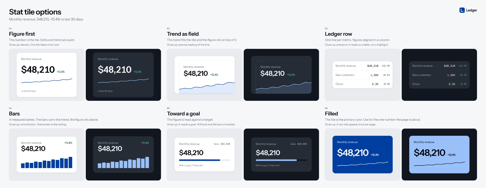

# Paper design system skills

Skills for working with a design system in [Paper](https://paper.design) alongside an agent. Bring in tokens and components, organize the file, explore alternatives, and prepare designs for review.

[Read the illustrated guide](docs/usage.md)



## Install

From a local checkout:

```bash
npx skills add . --skill '*'
```

From GitHub:

```bash
npx skills add jal-co/jalco-paper-skills --skill '*'
```

If the repository is private, your Git credentials must have access.

Install the whole set. Skills call one another and use references packaged with the other skills. Installing one alone may leave those references unavailable.

Use `--list` to see the available skills without installing them. See the [skills CLI](https://github.com/vercel-labs/skills) for agent selection and global installation.

## Before you start

- Connect your agent to the Paper MCP and open the file you want to work in.
- Give it access to the project's tokens, components, and logo assets.
- For Figma import, connect a Figma MCP and provide the file or node URL.
- Mobbin is optional. Existing Paper designs, screenshots, or the content itself can supply references.

These are instructions for an agent, not a plugin that adds controls to Paper. Installing the skills does not connect the MCP servers.

## Start here

> Use paper-ds-setup to connect this project's design system to my Paper file. The product ships dark mode only. Ask me about the sheet defaults before drawing.

Setup creates Foundations and TEMPLATE pages and a `paper-ds.json` file in your project. The manifest records the Paper file, token source, themes, and imported components.

Then ask for work:

> Use paper-ds-options to show six alternatives for our inline notice. Use its real labels and our existing components.

The agent chooses the comparison before drawing. A revision gets Current/Proposed; a behavior check gets states or real widths; an exploration gets distinct directions. See [choosing a comparison](docs/usage.md#choose-the-comparison).

Or review one thing:

> Use paper-ds-review to review this button. Show its long-label and disabled states in context. Keep findings in chat, not on the sheet.

## Skills

| Skill | Use it for |
| --- | --- |
| [paper-ds-setup](docs/usage.md#paper-ds-setup) | Connect a project and set up Foundations and TEMPLATE |
| [paper-ds-tokens](docs/usage.md#paper-ds-tokens) | Sync tokens, compare drift, or generate a new set |
| [paper-ds-components](docs/usage.md#paper-ds-components) | Import component variants and states |
| [paper-ds-pages](docs/usage.md#paper-ds-pages) | Organize pages, name layers, and audit an existing file |
| [paper-ds-options](docs/usage.md#paper-ds-options) | Choose the right sheet and run an exploration |
| [paper-ds-options-component](docs/usage.md#paper-ds-options-component) | Alternatives for one component |
| [paper-ds-options-block](docs/usage.md#paper-ds-options-block) | Alternatives for a section made from components |
| [paper-ds-options-page](docs/usage.md#paper-ds-options-page) | Whole-page directions |
| [paper-ds-review](docs/usage.md#paper-ds-review) | Review one design without generating alternatives |
| [paper-ds-canvas](docs/usage.md#paper-ds-canvas) | Shared Paper tool and rendering rules |

## Customize the sheets

Edit a frame on TEMPLATE to change the look of future sheets. Spacing, type, and radii reference your system's tokens. Layers named `Optional Logo`, `Optional Trade-off`, and `Optional Notes` can be removed when they are not needed.

Reviews have no drawn comments, pins, or findings. The design stays on the sheet; critique stays in chat or Paper's native comments.

## Status

The screenshots come from a sample system called Ledger. The Foundations, templates, and stat tile exploration were built in Paper while developing these skills. Empty stages in the template screenshots are intentional.

Code imports, Figma imports, reverse token sync, and dark-only setup still need end-to-end testing. The screenshots demonstrate layouts, not completed imports from an external system.

## License

[MIT](LICENSE). Copyright 2026 Justin Levine.
