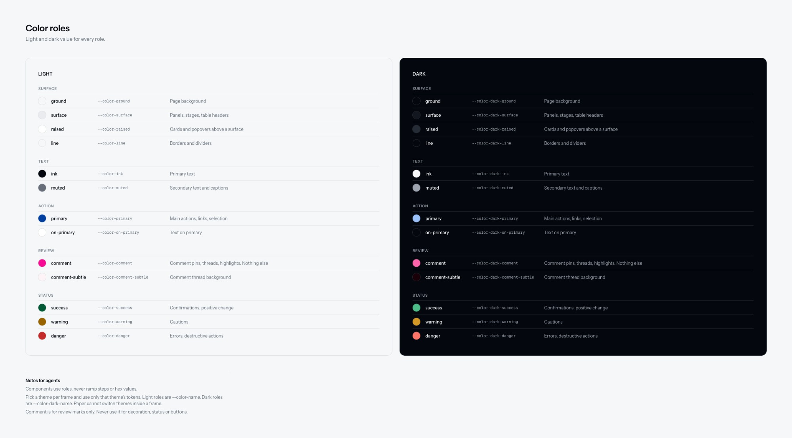
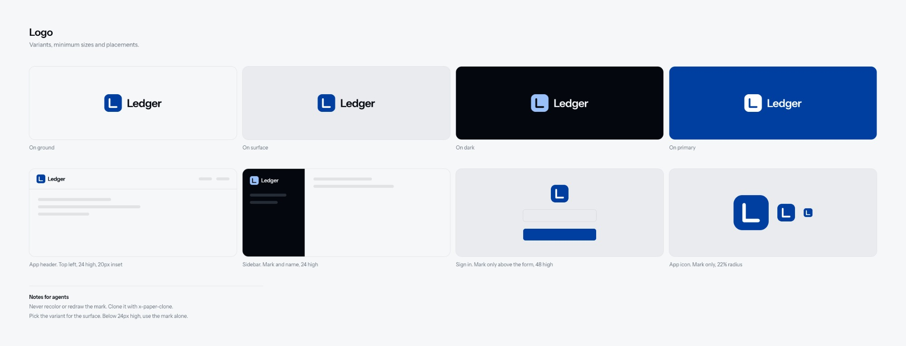
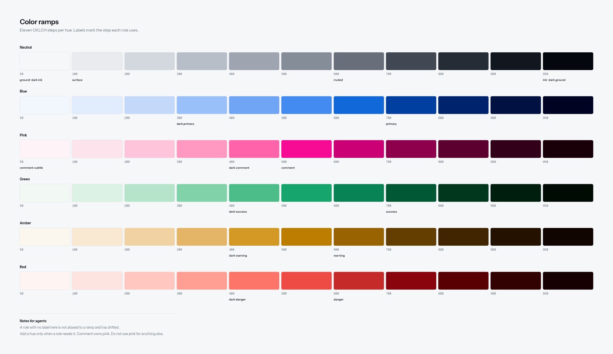
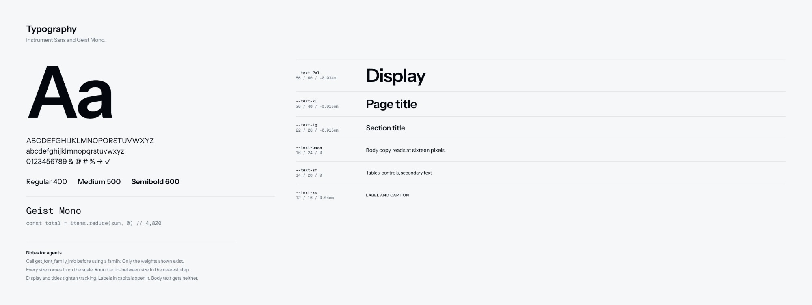
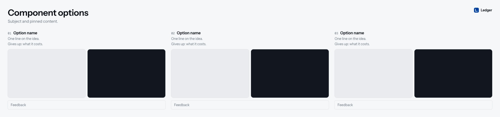
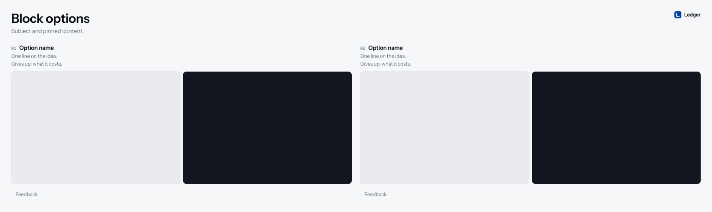
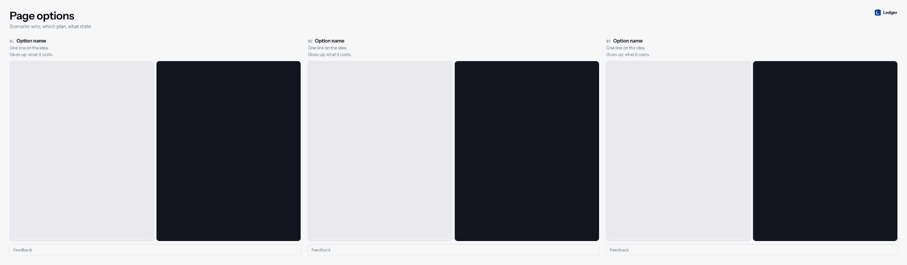
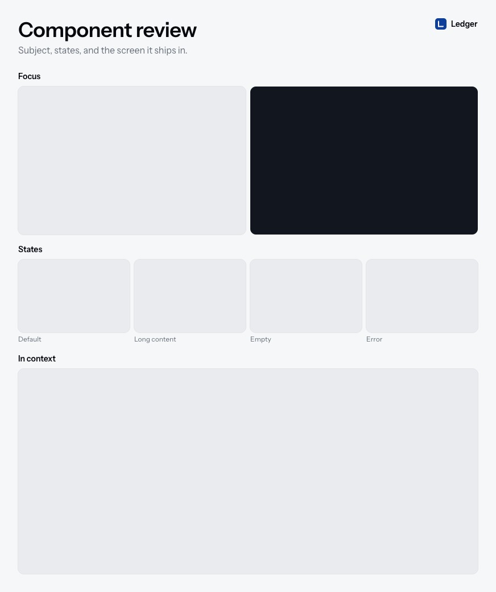

# Using the Paper skills

[Back to the README](../README.md)

Use the skill name in a request to your agent. A slash command may also be available, depending on the agent. Each example below supplies enough context to start; substitute your own component, source path, or Paper URL.

## A typical workflow

1. Run `paper-ds-setup` once to connect the project and choose themes, logo, and sheet defaults.
2. Run `paper-ds-components` for the components the next task will use.
3. Run `paper-ds-options` to compare alternatives, or `paper-ds-review` to inspect one design.
4. Give feedback by option name or node. Refine the survivors in context.
5. Use `paper-ds-tokens` when code tokens change, and `paper-ds-pages` when the file needs organizing.

You do not need to import an entire library before exploring one component. Start with the pieces that task needs.

## paper-ds-setup

[Skill instructions](../skills/paper-ds-setup/SKILL.md)

Connects the project to a Paper file and builds its Foundations and TEMPLATE pages. It asks about supported themes, logo assets, numbering, stage background, and optional slots before drawing.

> Use paper-ds-setup for this repo and my open Paper file. Tokens are in src/theme.css. We ship dark mode only, and the logo is in public/brand.svg. Keep the sheets compact.

Foundations gives each topic its own artboard: color roles, ramps, typography, spacing and radius, logo, and font stacks. Notes on these artboards tell agents how to use the system. They are separate from review findings.



Logo artboards show available variants and placements. The logo slot in a sheet's header uses the supplied asset, not a newly invented mark.



Setup writes `paper-ds.json` in the project. Keep it with the project so later sessions can locate the file, token source, and component nodes.

## paper-ds-tokens

[Skill instructions](../skills/paper-ds-tokens/SKILL.md)

Use this when tokens change or you need to compare code with Paper. The default direction is code to Paper. Ask explicitly to pull Paper edits back into code.

> Use paper-ds-tokens to compare src/theme.css with Paper. Show missing and changed tokens, then sync the code values into Paper. Leave Paper-only tokens alone.

For a project without tokens:

> Use paper-ds-tokens to propose a new system. Show the palette before writing it to code or Paper.

Roles point to ramp steps where the system defines that relationship. The Foundations ramp display makes those mappings visible.



Font families, type sizes, line heights, and tracking belong to the same system. The type display shows the families and scale together.



## paper-ds-components

[Skill instructions](../skills/paper-ds-components/SKILL.md)

Brings components into Paper as reusable instances. It reads variants, sizes, and states from source and stories, rather than drawing a similar-looking substitute.

> Use paper-ds-components to bring in Button, Badge, and Notice from src/components. Use the stories for real content and states. Do not import the rest of the library yet.

The Components page gets one artboard per component, with a variant/size matrix and relevant states. Instances have names such as `Badge warning subtle sm`. Later sheets clone those instances.

The manifest records the source file and Paper node. Unsupported effects are recorded as divergences rather than silently treated as exact copies. There is no imported component matrix in the demo screenshots yet.

### Starting from Figma

Connect a Figma MCP and provide the system or component URL:

> Use paper-ds-components to bring these Figma button variants into Paper. Preserve their names and resolve variables before drawing.

The [Figma reference](../skills/paper-ds-options/references/figma.md) describes the import procedure. Import only the components or frames needed for the task. This path still needs an end-to-end test.

## paper-ds-pages

[Skill instructions](../skills/paper-ds-pages/SKILL.md)

Organizes a file and audits existing pages before proposing moves.

> Use paper-ds-pages to audit this file. Propose page moves and layer renames before changing my organization.

The intended page order is:

```text
TEMPLATE
Foundations
Components
Blocks
Explorations, one page per subject
Archive
```

Use subject names such as `Billing page` or `Notice`. Structural layers get readable names: `Header row`, `Option 01 Usage first`, `Stage dark (Render)`, and `Optional Logo`. Names use spaces, not decorative separators.

Paper's MCP cannot lock layers. Lock finished Foundations and TEMPLATE artboards manually in Paper. Agents should clone from them and ask before changing them. See the [naming and locking reference](../skills/paper-ds-pages/references/naming.md).

## paper-ds-options

[Skill instructions](../skills/paper-ds-options/SKILL.md)

The main exploration skill. It chooses a component, block, or page sheet, pins the content, lists distinct structural ideas, and draws with the project's system.

> Use paper-ds-options for six directions for our revenue tile. Keep the same data in every option, reuse the existing components, and recommend a direction after checking it in context.

References are optional. With Mobbin connected, the agent can look for structural precedents. Otherwise it can use existing Paper pages, supplied images, Figma references, or reason from the content itself. You do not need Mobbin to use these skills.


This example shows a populated sheet. The templates below have empty stages because they are starting frames, not finished designs.

After feedback, ask for a narrower round:

> Keep options 01 and 04. Show both inside our real dashboard, with a long value and an empty state. Leave the first round intact.

## Choose the comparison

The agent first identifies the decision, then picks a sheet. A component does not always need a grid of alternatives.

| You want to know | Use |
| --- | --- |
| Which structure is better | Different directions with the same content |
| Whether a revision improves the current UI | Current and Proposed side by side |
| Whether a component handles its states | A state matrix, not extra directions |
| Whether content breaks it | Normal, long, empty, or error examples of the same design |
| Whether both themes work | Light/dark pairs, only for themes the product ships |
| Whether it reflows correctly | The same design at real container widths |
| Whether an icon or footer is needed | With and Without that one slot |
| Whether it fits the product | The design inside its real surrounding screen |
| Which colors or fonts work | Matched foundation specimens, including text on surfaces and realistic copy |
| Whether a journey works | Ordered steps for the same goal |
| Whether one design is ready | A single-subject review |

The [comparison guide](../skills/paper-ds-options/references/comparisons.md) gives the layout and fixed variables for each. Templates supply the look; they do not dictate how many candidates to invent.

## paper-ds-options-component

[Skill instructions](../skills/paper-ds-options-component/SKILL.md)

Alternatives for one component: a button, badge, notice, tile, or menu.

> Use paper-ds-options-component for our inline notice. Compare four structures using the same warning message and action. Reuse our actual Badge.

The starting sheet has three options across. Each stage shows the component at its real size. Add only the states that affect the choice, and grow the stage when the component needs more room.



## paper-ds-options-block

[Skill instructions](../skills/paper-ds-options-block/SKILL.md)

Alternatives for a section made from components: a pricing table, settings panel, empty state, or onboarding section.

> Use paper-ds-options-block for our plan comparison section. Keep the plans, prices, and labels fixed. Explore a table and a stacked layout using our existing cards and buttons.

Blocks compare grouping, order, and action placement. The template starts with two options across. Optional parts stay optional, so a footer or icon is not required to make the layout work.



## paper-ds-options-page

[Skill instructions](../skills/paper-ds-options-page/SKILL.md)

Whole-page directions. Each direction should change what the page leads with, not just rearrange a few cards.

> Use paper-ds-options-page for Billing. Scenario: free plan, two serverless projects, no card on file. Compare usage-first, plan-first, and projects-first using the real billing labels and data.

Pin one scenario per sheet. If an empty account needs a different layout, give it its own sheet. Reuse the same shell across directions so the comparison stays about the page content.



## paper-ds-review

[Skill instructions](../skills/paper-ds-review/SKILL.md)

Inspect one existing design without generating alternatives.

> Use paper-ds-review for this Notice node. Show its long-message and error states and place it in the Agent Builder screen. Return findings in chat. Do not draw comments or pins on the sheet.

The sheet holds only the subject, its relevant states, and context. Remove the states strip when it adds nothing. Remove the in-context stage when reviewing a whole screen.



Findings belong in the reply, not on the design. Existing native Paper comments can be read as review input. Changing or resolving those threads needs permission.

## paper-ds-canvas

[Skill instructions](../skills/paper-ds-canvas/SKILL.md)

Shared drawing rules loaded by the other skills. You normally do not need to invoke it yourself.

> Use paper-ds-canvas to investigate why this artboard is blank and check whether the screenshot is stale before rewriting anything.

It covers token references, fonts, node IDs, screenshot checks, transparent overview artboards, and rendering limits. If Paper cannot reproduce an effect, the agent records that difference.

## Customize your templates

Edit the TEMPLATE frames directly. The next sheet inherits those edits; existing sheets do not change automatically.

- Spacing, padding, type, and radii reference your DS tokens.
- Stage dimensions are starting sizes. Content can require larger stages.
- `Optional Logo` is the system's logo in the header.
- `Optional Trade-off` is a short cost beneath an idea's pitch.
- `Optional Notes` is a removable feedback slot on option sheets. Review sheets have no such slot.

Delete an optional layer from a clone for one task, or from the template to remove it from future sheets. Do not pad a sheet with placeholder commentary.

## Choose only the themes you ship

Setup records `themes` in the manifest:

| Product | Manifest | Sheet |
| --- | --- | --- |
| Light and dark | `["light", "dark"]` | One stage per theme |
| Dark only | `["dark"]` | One dark stage |
| Light only | `["light"]` | One light stage |

A single-theme system uses plain role names such as `--color-ground`. A two-theme system also has `--color-dark-ground`. Spacing, type, and radii are shared.

The screenshots show both themes because the sample system has both. A dark-only project should not get an empty light stage.

## Scope of the examples

The screenshots show Ledger, an invented sample system. Its palette, font pairing, and brand are not required. The source Paper file is private and is not linked here.

The demonstrated layouts were built in Paper. External component imports, Figma imports, reverse token sync, and a full single-theme setup still need end-to-end testing. No production-code handoff skill is included yet.
