# Manage the system, then iterate on real components

[Back to the README](../README.md)

The workflow is a loop: maintain the real system, start with an actual component, compare the decision, iterate on selected nodes, verify in context, and adopt the approved result. These skills divide up that work without replacing the way you already use Paper.

Use a skill's name in the request to your agent. Examples below use illustrative source paths and component names, not a shared demo-file link.

## What to use when

**Start with `paper-ds-manage`.** Describe the task and it routes to the right skill. Use a focused skill directly when you already know the job.

| Job | Skill |
| --- | --- |
| First connection | [paper-ds-setup](#paper-ds-setup) |
| Token sync or drift | [paper-ds-tokens](#paper-ds-tokens) |
| Real component imports or refreshes | [paper-ds-components](#paper-ds-components) |
| Alternatives or Current/Proposed | [paper-ds-options](#paper-ds-options) |
| Changes to selected nodes after feedback | [paper-ds-iterate](#paper-ds-iterate) |
| Verify one design in context | [paper-ds-review](#paper-ds-review) |
| Adopt an approved revision and optionally implement it | [paper-ds-land](#paper-ds-land) |
| Page organization, naming, and archives | [paper-ds-pages](#paper-ds-pages) |

The usual sequence is **Manage → options → iterate → review → land**. Setup happens once. Refresh tokens and components when needed, not before every task. A selected option is still a draft until approved; approval is still separate from verified implementation.

The component, block, and page option skills are format helpers. The canvas skill is shared tool guidance. The entry skills load these for you; you generally do not invoke them directly.

## The shadcn worked example

The screenshots below come from a run using shadcn/ui's documented default neutral theme and `base-nova` registry recipes, in light and dark. Components were read from the official registry, not styled to vaguely resemble shadcn. Geist is the sample app font; the component recipes inherit the application's font.

The run imported 15 components and preserved source snapshots. Each canonical component has its own page, and Components is a compact index. Their order keeps inputs and selection controls together, followed by navigation, surfaces, feedback, and loading primitives:

```text
TEMPLATE
Foundations
Components
  Button, Badge, Input, Textarea
  Checkbox, RadioGroup, Switch
  Slider, Progress, Tabs, Avatar
  Card, Alert, Separator, Skeleton
Alert exploration
Alert review
Archive
```

The indentation describes the group, not nested Paper pages. New pages are reordered into that group as soon as they are created; Paper otherwise inserts them beside the active page.

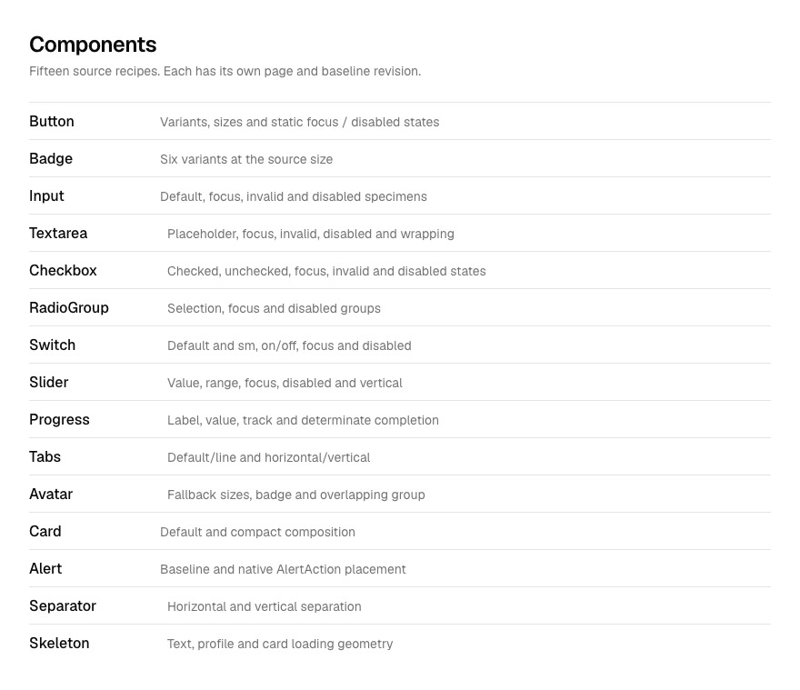

### What does r3 mean?

It is the third captured Alert design revision, not shadcn version 3:

| Revision | What was captured | Status |
| --- | --- | --- |
| r1 | The source recipe, including its native top-right action | Canonical baseline |
| r2 | Native action, below-description action, and separated-footer comparisons | Draft |
| r3 | Below-description action with more separation, then long-content, 240px-container, and billing-context checks | Draft awaiting a decision |

The action label and message stayed fixed during the structural comparison. Canonical Alert still points to r1. r3 has no recorded approval or verified implementation.

This run exercised source lookup, static specimens, local checkpoints, and layout review. It did not test interaction behavior or complete the adoption-to-code loop. [Open the approved Paper demo](https://app.paper.design/file/01M4YB3J8ZFB5RE8JA0T21YQV8/p-3-0). The [image index](demo.md) lists screenshots from that copy; the original file remains private.

## paper-ds-manage

[Skill](../skills/paper-ds-manage/SKILL.md)

The entry point for ongoing work. It reads the manifest, source, revisions, and selected nodes before choosing the next step. It does not rerun setup just because a new session started.

> Use paper-ds-manage on Alert. Read its source and my selected Paper nodes before drawing. I want to keep the structure but make it work with longer messages.

The request goes to focused iteration and content checks, not a new six-option exploration.

## paper-ds-setup

[Skill](../skills/paper-ds-setup/SKILL.md)

Connect code or Figma, supported themes, fonts, logo assets, and editable sheet defaults. Setup creates or reconciles Foundations and TEMPLATE and writes `paper-ds.json` with schema version 2.

> Connect this repo to my Paper file. Tokens are in src/theme.css, components are in src/components, and we ship dark mode only. Use public/brand.svg for the logo.

The agent reuses existing pages and asks before reconciling them. No real tokens or logo means ask about generation or omission, not substitute the sample system.

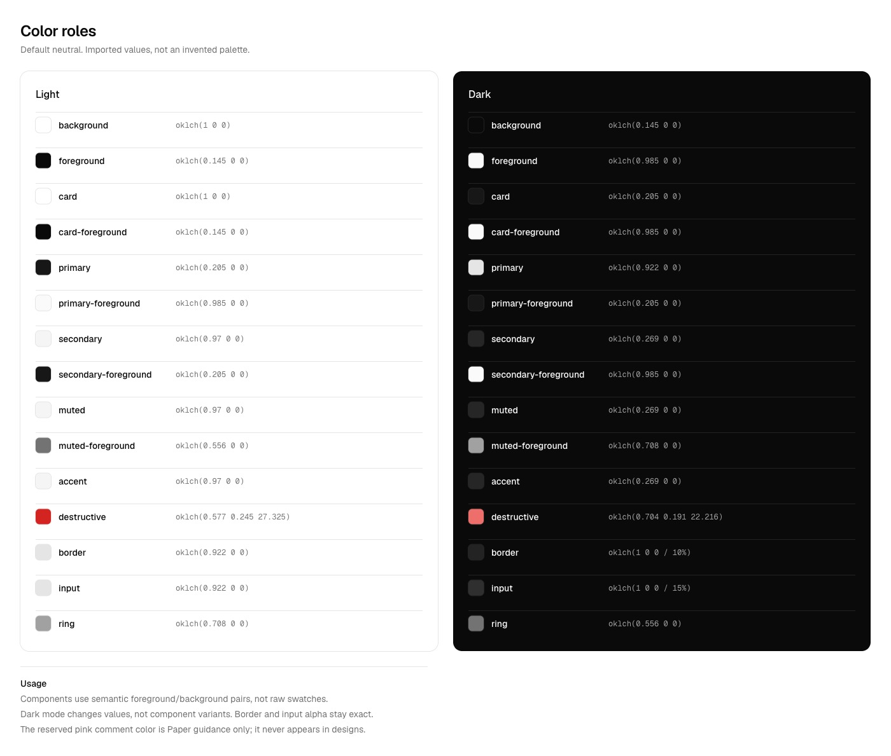

The run did not invent a logo. When a project supplies real logo assets, setup documents their variants and placements and clones them into optional sheet slots.

Notes under Foundations artboards explain usage. They are editable system guidance, not review comments. Setup asks the user to lock finished artboards manually when wanted; Paper's MCP cannot lock them.

## paper-ds-tokens

[Skill](../skills/paper-ds-tokens/SKILL.md)

Keep the selected source and Paper aligned. Before a shared change, save the old tokens. After verification, save the new snapshot and mark affected components for review. Source values and aliases stay exact.

> Compare src/theme.css with Paper. Show conflicts with my canvas edits before syncing. Leave Paper-only tokens alone.

A sync does not approve or implement every affected component. A pull back into code must be requested explicitly.

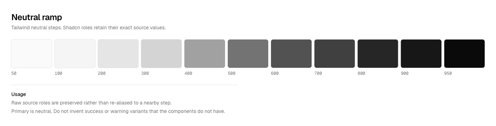

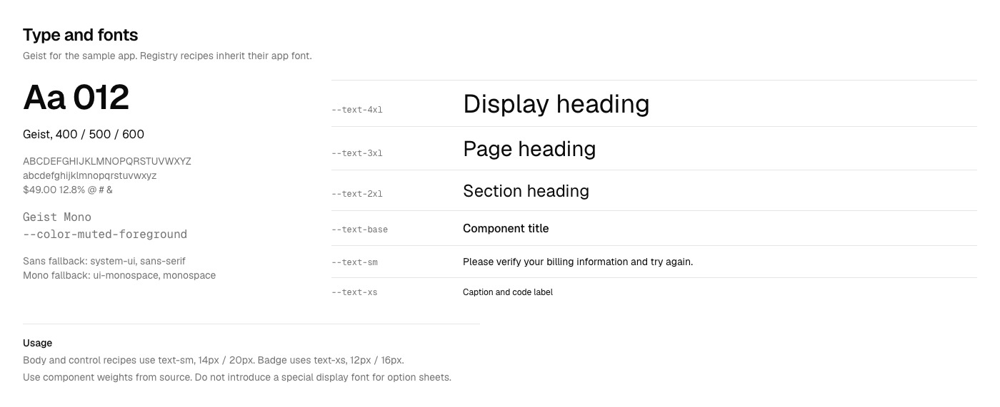

The run also caught a read-back limit: Paper reports OKLCH hues rounded to one decimal place. Original source values remain in the local snapshot, and reported precision differences are recorded rather than claimed as exact round-trip fidelity.

For a new system, ask for a proposed palette and type scale first. That is a separate task from importing an existing one.

## paper-ds-components

[Skill](../skills/paper-ds-components/SKILL.md)

Bring in actual recipes, props, states, and usage guidance from source or Figma. Import only what the task needs and save a baseline revision. Refreshing a component does not erase active drafts or user edits.

> Bring in Alert and Badge from src/components. Use our stories for real content and states. Preserve the existing Alert exploration.

Each canonical component has its own page, such as Button, Badge, or Alert. Components is a compact index. Alert exploration and Alert review stay separate from the Alert baseline page. Instances get names such as `Button outline xs` so later work can clone the actual component. Unsupported effects are recorded as divergences. An import is not evidence that a proposed design was implemented.

The expanded run includes Checkbox, Switch, RadioGroup, Slider, Progress, Tabs, Avatar, Textarea, Separator, and Skeleton alongside Button, Badge, Card, Input, and Alert. Their matrices show real source sizes and relevant static states, not invented variants.

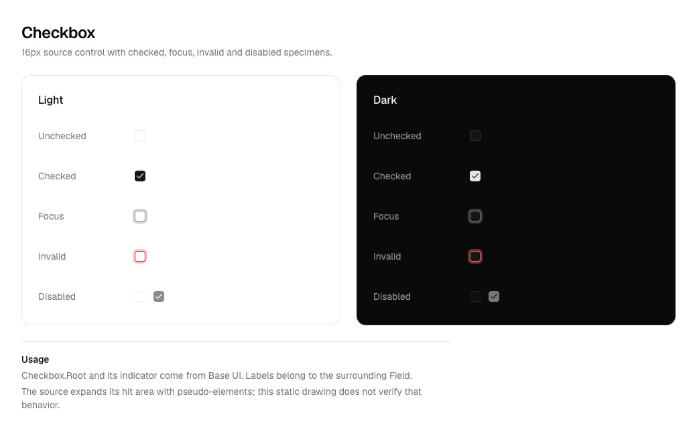

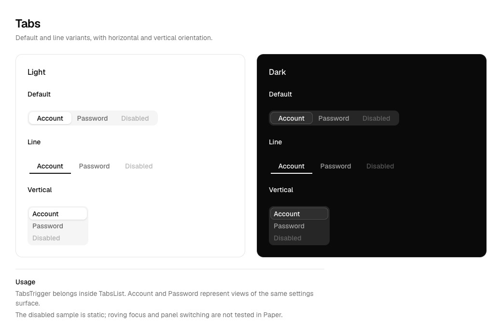

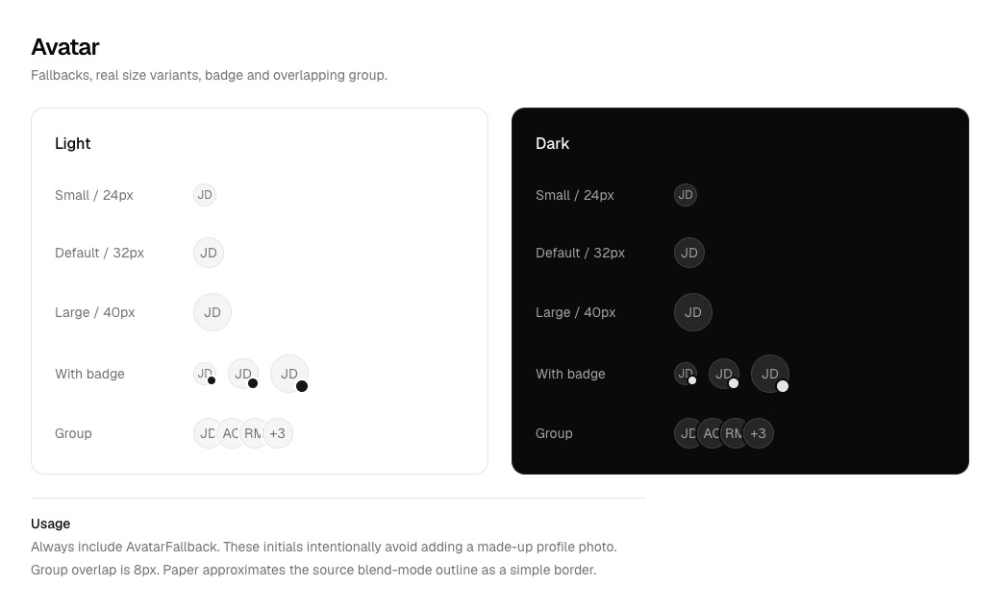

Focus and disabled are drawn states. Keyboard behavior, slider dragging, expanded hit areas, and loading animation still require a browser test. Unsupported effects are noted instead of silently declared exact.

For Figma, connect its MCP and supply the requested component URL. The [import reference](../skills/paper-ds-options/references/figma.md) preserves source values and names. That path still needs end-to-end testing.

## paper-ds-options

[Skill](../skills/paper-ds-options/SKILL.md)

Start with the current baseline and decide what comparison is useful before choosing a template.

> Explore three structures for Alert with the same warning message and action. Use our real Badge and preserve the current version for comparison.

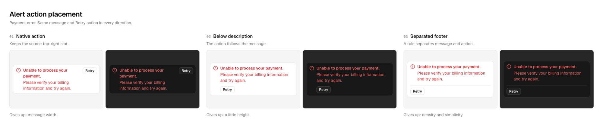

The screenshot shows three structural choices, not a rule that every request needs six candidates. References can come from Mobbin, Figma, existing Paper pages, or supplied images. No reference service is required.

### Choose the comparison

| Decision | Comparison |
| --- | --- |
| Choose a structure | Distinct directions with fixed content |
| Improve a revision | Actual Current and Proposed |
| Check behavior | Actual states, not extra directions |
| Check content resilience | Normal, long, empty, or error content |
| Check theme fidelity | Only the shipped themes |
| Check responsive behavior | Reflow at real container widths |
| Check an optional part | With and Without that one part |
| Check fit with the product | The same subject inside its real surrounding screen |
| Choose colors or fonts | Matched specimens and text-on-surface checks |
| Explore a journey | Complete ordered steps for one goal |
| Verify one subject | A single-subject review |

The [comparison guide](../skills/paper-ds-options/references/comparisons.md) defines which variables stay fixed. Template capacity is not a candidate count.

## paper-ds-options-component

[Skill](../skills/paper-ds-options-component/SKILL.md)

Component-sized comparisons, using real pixel sizes. Stages grow when the subject needs more space. Relevant states appear only when they affect the decision.

> Compare Current and Proposed padding on this button with identical text and width. Do not invent other button styles.

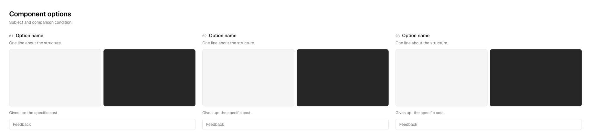

## paper-ds-options-block

[Skill](../skills/paper-ds-options-block/SKILL.md)

Section-sized comparisons made from real components. Compare grouping, order, action placement, or the one optional slot in question.

> Compare our pricing block with and without the footer. Keep the plans, data, and card components fixed.

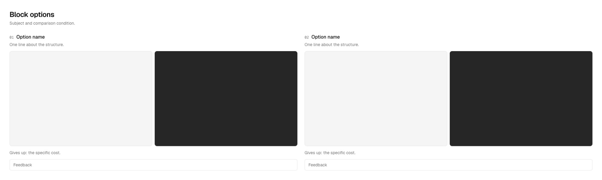

## paper-ds-options-page

[Skill](../skills/paper-ds-options-page/SKILL.md)

Page directions or ordered flow steps. Keep the same scenario and actual shell across structural directions. A state or revision check retains the page direction instead.

> Compare usage-first and projects-first Billing for a free plan with two projects and no card. Keep the existing sidebar and real billing labels.

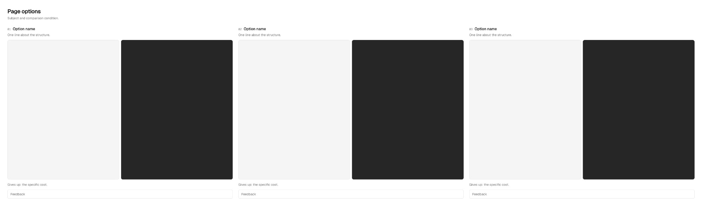

## paper-ds-iterate

[Skill](../skills/paper-ds-iterate/SKILL.md)

Continue from feedback and the user's selected nodes. The agent reads your edits before changing anything, captures the starting point, and keeps the next round bounded.

> Keep these two nodes. Preserve my padding changes, use the actual Badge, and show the long error inside our settings page.

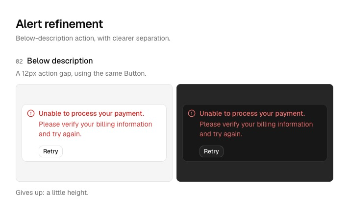

Rejected directions are not regenerated. A requested API or token exception is reported as a proposal, not silently added. Drafts record their parent revision so you can see what changed.

## paper-ds-review

[Skill](../skills/paper-ds-review/SKILL.md)

Verify the selected revision against its real system, states, themes, widths, and neighboring UI. Reuse an adequate existing display rather than always making a new sheet.

> Review Alert r3 in the real settings page. Check its long-message and error states in dark mode. Findings belong in chat.

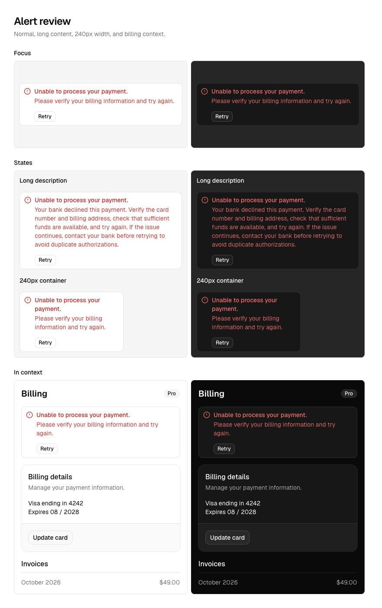

There are no drawn comments, pins, or findings. Reviews record the examined revision, token snapshot, completed checks, and unresolved problems. A clean review is not user approval or proof of implementation. Native comment actions need explicit permission.

## paper-ds-land

[Skill](../skills/paper-ds-land/SKILL.md)

Close the loop. Adopt a specifically approved revision into the maintained system and implement it only when requested. Keep design approval and code verification separate.

> Adopt Alert r3 and implement it in our existing Alert component. Update its stories and usage guidance. Verify the real states and compare screenshots with Paper. Do not push or deploy.

The agent captures the previous canonical version, updates the approved artwork and guidance, reads direct Paper values for code, and runs the project's checks and visual comparison. Failed checks or unresolved fidelity differences leave implementation incomplete.

For design-only work:

> Adopt Alert r3 in Paper only. Leave the implementation unchanged and record the remaining drift.

## paper-ds-pages

[Skill](../skills/paper-ds-pages/SKILL.md)

Keep the file navigable without losing history. The agent proposes moves, preserves the user's organization, and updates manifest references after approved changes.

> Organize the Alert rounds and archive the rejected ones. Preserve their snapshots and my page grouping.

Canonical component names stay stable. Explorations use short names such as `Alert r3 Round 2`. Revisions live in the manifest, not big metadata panels on the canvas. See [naming and locking](../skills/paper-ds-pages/references/naming.md).

## paper-ds-canvas

[Skill](../skills/paper-ds-canvas/SKILL.md)

Shared drawing and checkpoint rules. Other skills load it before using Paper. It handles file identity, fonts, token references, transparent overview frames, screenshot lag, and rendering limits.

> Check whether this screenshot is stale before rewriting the component. Read the node and token snapshot first.

## Templates and themes

Edit TEMPLATE directly to change future sheets. Spacing, type, and radii reference your DS tokens. Optional logo, trade-off, and feedback slots can be removed. Critique stays off the canvas, and review sheets have no feedback slots.

One-theme systems use one stage per option. A dark-only `--color-ground` is dark. Two-theme systems also have `--color-dark-*` roles. Do not add empty light stages to a dark-only project.

## Preserve the lineage

Read [versioning](versioning.md). Component revisions, manifest schema, and package releases have different meanings. Current artwork, approved design, and verified implementation are tracked separately. Shared token changes flag affected subjects for review.

The screenshots show the source-based shadcn run, not a shipped application. The billing screen is a fixture assembled from imported components. Adoption, implementation fidelity, historical restore, reverse sync, Figma import, and a full single-theme setup still need end-to-end testing. Only the approved demo copy is linked. The original file and private project history remain excluded.
